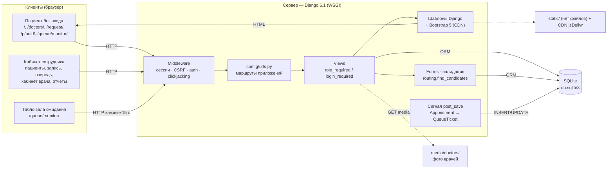
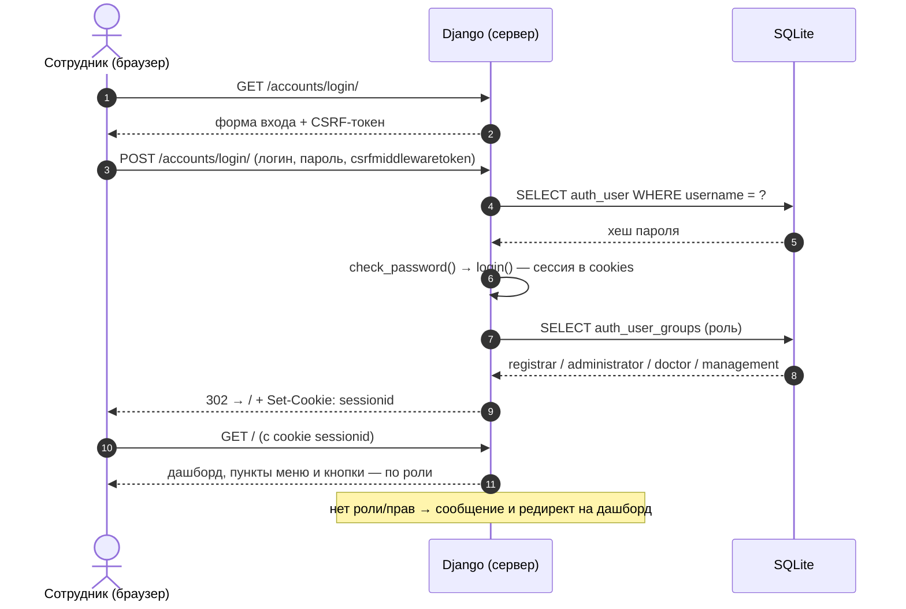
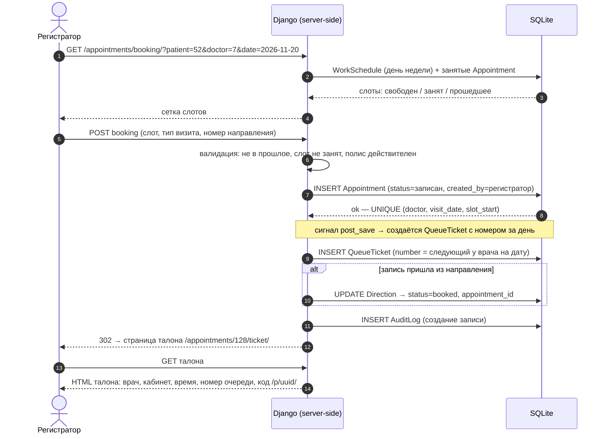
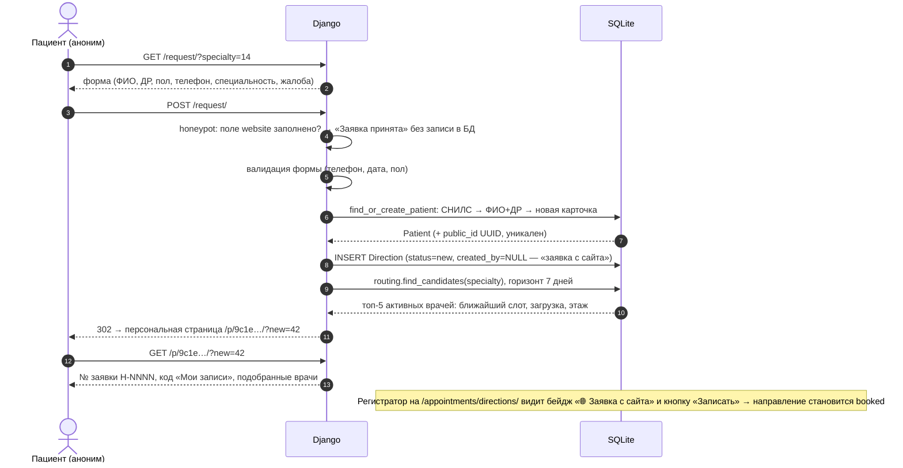
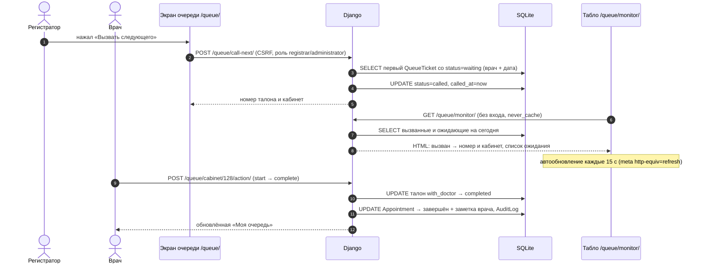

# Регистратура

Веб-система автоматизации регистратуры медицинского учреждения: запись на приём,
электронная очередь, справочники и отчёты — плюс публичные экраны для пациентов
без учётной записи.

**Стек:** Python 3.14 · Django 6.1.1 · SQLite · серверные шаблоны Django + Bootstrap 5 (CDN).

---

## 1. Цель

Заменить бумажные журналы и телефонные записи единой системой, в которой:

- **пациент** может найти врача, оставить заявку и узнать свои записи без визита
  в поликлину и без регистрации;
- **регистратор** записывает, переносит и отменяет записи, выдаёт талоны и
  управляет потоком пациентов из зала ожидания;
- **врач** видит свою очередь и проводит приём в кабинете, назначая повторные
  визиты и направления;
- **администратор** ведёт справочники (специальности, отделы, врачи, кабинеты,
  расписания) и пользователей;
- **руководство** видит статистику: загрузку врачей, неявки, поток пациентов.

Ожидаемый эффект: сокращение очередей и неявок (подбор ближайшего свободного
врача, напоминание о слоте на талоне), отсутствие двойных записей (жёсткая
проверка слота) и прозрачная аналитика.

---

## 2. Пользовательские истории

Формат: *Как …, я хочу …, чтобы …* Ссылки — на варианты использования
([docs/use-cases.md](docs/use-cases.md)) и экраны.

### Регистратор

- Как регистратор, я хочу найти пациента по ФИО, телефону или СНИЛС, чтобы
  быстро открыть его карточку. → `/patients/` (UC2)
- Как регистратор, я хочу зарегистрировать нового пациента с полисом ОМС/ДМС,
  чтобы записать его впервые. → `/patients/new/` (UC3)
- Как регистратор, я хочу выбирать врача, дату и свободный слот из сетки, чтобы
  записать пациента без ошибок. → `/appointments/booking/` (UC5)
- Как регистратор, я хочу переносить и отменять записи с указанием причины,
  чтобы слоты не оставались пустыми. → `/appointments/<pk>/move|cancel` (UC6)
- Как регистратор, я хочу печатать талон с врачом, кабинетом, временем, номером
  очереди и ссылкой «Мои записи», чтобы пациент знал, когда прийти.
  → `/appointments/<pk>/ticket/` (UC7)
- Как регистратор, я хочу вызывать следующего пациента из зала ожидания, чтобы
  очередь двигалась. → `/queue/` (UC13)
- Как регистратор, я хочу видеть заявки с сайта и направления врачей в одном
  списке, чтобы записать пациента к подходящему свободному врачу.
  → `/appointments/directions/` (UC19, UC22)

### Администратор

- Как администратор, я хочу вести справочники специальностей, отделов, врачей и
  кабинетов, чтобы данные о приёме были актуальны. → `/schedule/*` (UC9)
- Как администратор, я хочу распределять врачей по отделам и смотреть структуру
  «отдел → специальность → врачи» и кабинеты по этажам, чтобы пациенты
  ориентировались в здании. → `/schedule/structure/`, `/schedule/floors/` (UC9)
- Как администратор, я хочу вести недельные расписания приёма с длительностью
  слота, чтобы сетка записи строилась корректно. → `/schedule/work-schedules/` (UC10)
- Как администратор, я хочу создавать пользователей и назначать роли, чтобы
  каждый видел только свои разделы. → `/admin/` (UC11)
- Как администратор, я хочу смотреть отчёты с фильтрами «период / врач / отдел /
  специальность», чтобы оценивать работу регистратуры. → `/reports/` (UC16)
- Как администратор, я хочу открывать кабинет любого врача, чтобы контролировать
  приём. → `/queue/cabinet/?doctor=<id>`

### Врач

- Как врач, я хочу видеть свою очередь на сегодня с карточками пациентов
  (полисы, прошлые визиты), чтобы готовиться к приёму. → `/queue/cabinet/` (UC12)
- Как врач, я хочу открывать приём, завершать его с заметкой и отмечать неявку,
  чтобы история визитов была точной. → `/queue/cabinet/<pk>/action/` (UC14)
- Как врач, я хочу назначать повторный визит одной кнопкой, чтобы не заполнять
  форму заново. → (UC15)
- Как врач, я хочу выписывать направление пациенту на другую специальность,
  чтобы он попал к нужному специалисту. → `/appointments/directions/new/` (UC19)
- Как врач, я хочу видеть только свои отчёты по загрузке и неявкам, чтобы
  оценивать собственную практику. → `/reports/` (UC16)
- Как врач, я хочу, чтобы чужой кабинет и чужие цифры были недоступны, —
  объектная изоляция по умолчанию. (roles-matrix)

### Руководство

- Как сотрудник руководства, я хочу видеть сводные отчёты за период (загрузка
  врачей, неявки, поток пациентов), чтобы принимать решения.
  → `/reports/` (UC16)
- Как сотрудник руководства, я хочу следить за табло вызова пациентов, чтобы
  видеть ситуацию в зале дистанционно. → `/queue/monitor/` (UC17)
- Как сотрудник руководства, я хочу просматривать справочники и структуру только
  на чтение, чтобы не нарушить данные. (roles-matrix)

### Пациент (без входа)

- Как пациент, я хочу выбрать врача в каталоге по отделу и специальности и
  увидеть его расписание, чтобы понимать, к кому идти. → `/doctors/` (UC18)
- Как пациент, я хочу оставить заявку на приём и получить список свободных
  врачей, чтобы не звонить в регистратуру. → `/request/` (UC22)
- Как пациент, я хочу увидеть свои записи и номер в очереди по коду или ссылке
  с талона, чтобы ничего не забыть. → `/p/<uuid>/` (UC21)
- Как пациент, я хочу смотреть монитор очереди в зале ожидания, чтобы не
  пропустить вызов. → `/queue/monitor/`
- Как посетитель, я хочу с главной страницы понять, как записаться за 3 шага, и
  пройти в нужный раздел. → `/` (UC20)

### Система (автоматизация)

- Как система, я должна создавать талон очереди с номером за день автоматически
  при каждой записи. (сигнал `post_save` в `apps/queue/models.py`)
- Как система, я должна закрывать талон при отмене записи и отмечать неявку, —
  статусы записи и талона синхронизированы. (UC5/UC6)
- Как система, я должна запрещать двойную запись в один слот и запись в прошлое.
  (`UniqueConstraint` `unique_active_slot`, валидация формы)
- Как система, я должна игнорировать «робочие» заявки, заполнившие скрытое поле
  honeypot, не создавая данных в БД. (UC22)

---

## 3. Схемы

### 3.1 Клиент — Сервер — БД (архитектура)



**Комментарии.** Клиент тонкий: только HTML и Bootstrap с CDN, JavaScript почти
нет (монитор очереди обновляется через `meta refresh` 15 с, копирование кода —
через Clipboard API с откатом на `execCommand`). Вся бизнес-логика — на сервере:
проверка ролей в декораторах, валидация в формах, подбор врача в
`apps/appointments/routing.py`, нумерация очереди в `apps/queue/models.py`.
База — один файл SQLite `db.sqlite3` (в git не входит).

### 3.2 Диаграммы последовательности (клиент → сервер → БД)

#### А. Вход сотрудника



#### Б. Запись на приём (регистратор)



#### В. Заявка на приём с сайта (пациент без входа)



#### Г. Электронная очередь и табло



### 3.3 Другие схемы

- **ER-диаграмма и статусы** — [docs/entities.md](docs/entities.md)
  (Patient, Appointment, Direction, QueueTicket, Doctor, WorkSchedule, Specialty,
  Department, Cabinet, User/AuditLog).
- **Диаграмма вариантов использования** — [docs/use-cases.md](docs/use-cases.md) (UC1–UC22).
- **Матрица ролей и прав** — [docs/roles-matrix.md](docs/roles-matrix.md)
  (4 роли + публичные экраны, object-level доступ).

---

## 4. Инструкции по запуску

Требования: **Python 3.12+** (разработано на 3.14), `pip`, `curl` — для smoke-теста.

```bash
# 1. Виртуальное окружение и зависимости
python3 -m venv .venv
.venv/bin/pip install -r requirements.txt      # django==6.1.1

# 2. База данных и права
.venv/bin/python manage.py migrate             # создаёт db.sqlite3
.venv/bin/python manage.py init_roles          # группы registrar/administrator/doctor/management

# 3. Демо-данные (справочники, расписание, врачи, пациенты, записи)
.venv/bin/python manage.py seed_demo           # идемпотентно, повторный запуск безопасен
# .venv/bin/python manage.py seed_demo --reset # пересоздать демо-данные с нуля

# 4. Суперпользователь для /admin/ (и для scripts/smoke.sh — логин admin)
.venv/bin/python manage.py createsuperuser

# 5. Запуск
.venv/bin/python manage.py runserver           # http://127.0.0.1:8000/
```

> `seed_demo` сам вызывает `init_roles`, так что шаг 2 можно пропустить, если
> запускаете только его.

### Учётные записи демо-данных

| Логин | Пароль | Роль |
|---|---|---|
| `admin` | `admin12345` | суперпользователь (создаётся вручную — см. шаг 4) |
| `registrar1`, `registrar2` | `registrar12345` | Регистратор |
| `doctor1` … `doctor15` | `doctor12345` | Врач (по врачу на специальность) |
| `manager` | `manager12345` | Руководство |

Роль «Администратор» (`administrator`) демо-данные не заводят — назначьте её
пользователю в `/admin/` (Пользователи → группа `administrator`) или работайте
от суперпользователя.

### Ключевые адреса

| Адрес | Что это | Доступ |
|---|---|---|
| `/` | лендинг для анонимов, дашборд после входа | все |
| `/accounts/login/` | вход сотрудника | все |
| `/request/` | заявка на приём с подбором врача | без входа |
| `/p/<uuid>/` | «Мои записи» пациента по коду | без входа |
| `/doctors/`, `/doctors/<pk>/` | каталог врачей и карточка | без входа |
| `/queue/monitor/` | табло зала ожидания | без входа |
| `/patients/` | пациенты: поиск, карточка, создание | регистратор, админ |
| `/appointments/`, `/appointments/booking/` | журнал записей, сетка слотов | регистратор, админ |
| `/appointments/directions/` | направления и заявки с сайта | все, кроме регистратора — создание |
| `/queue/`, `/queue/cabinet/` | общая очередь, кабинет врача | по ролям |
| `/schedule/` | справочники, структура, этажи | админ (структура/этажи — все) |
| `/reports/` | отчёты: загрузка, неявки, поток | админ, руководство, врач (свои) |
| `/admin/` | админка Django | staff |

### Проверка

```bash
scripts/smoke.sh        # поднимает сервер на :8001 и гоняет ~280 curl-проверок
```

Скрипт ожидает суперпользователя `admin/admin12345` и заполненную `seed_demo`.
Итог — `PASS=n FAIL=0` (ненулевой `FAIL` → ненулевой код возврата).

`manage.py test` — пока заготовки; фактическое покрытие даёт smoke-скрипт.

---

## 5. Структура проекта

```
project1/
├── manage.py
├── requirements.txt
├── README.md
├── config/                  # settings.py, корневые urls.py, wsgi/asgi
├── apps/
│   ├── accounts/            # роли (Group), декораторы, лендинг/дашборд
│   ├── patients/            # пациенты, полисы, публичная страница /p/<uuid>/
│   ├── schedule/            # специальности, отделы, врачи, кабинеты, расписания
│   ├── appointments/        # записи, слоты, направления, талоны, заявки с сайта
│   ├── queue/               # электронная очередь, кабинет врача, табло
│   └── reports/             # загрузка врачей, неявки, поток пациентов
├── templates/               # шаблоны Django (base, landing, разделы)
├── static/                  # локальные статические файлы (сейчас пусто)
├── media/doctors/           # фото врачей (не в git)
├── docs/
│   ├── use-cases.md         # варианты использования UC1–UC22
│   ├── entities.md          # ER-диаграмма и статусы
│   └── roles-matrix.md      # матрица ролей и прав
├── scripts/smoke.sh         # smoke-проверка через curl
└── db.sqlite3               # SQLite (не в git)
```

**Замечания по окружению:** `DEBUG=True`, `ALLOWED_HOSTS=[]`, `SECRET_KEY`
из `config/settings.py` — режим разработки; для продакшена настройте
`DEBUG=False`, `ALLOWED_HOSTS`, `SECRET_KEY` из окружения и сборку статики.
Часовой пояс `Asia/Tashkent`, интерфейс — русский.
