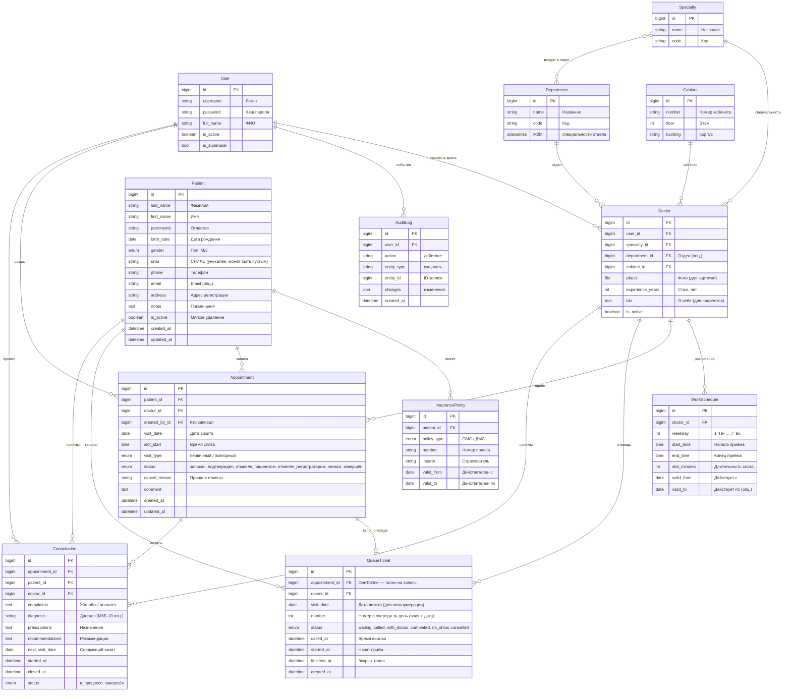

# Сущности (ER-диаграмма) — «Регистратура»

## Mermaid ER-диаграмма



## Ключевые замечания

### Статусы Appointment (запись)
```
записан → подтверждён → завершён
   │          │
   ├→ отменён_пациентом
   ├→ отменён_регистратором
   └→ неявка        (помечает регистратор/врач по факту)
```

### Статусы QueueTicket (талон очереди)
```
waiting → called → with_doctor → completed
   │         │          │
   │         │          └→ no_show (врач отмечает неявку)
   ├─────────┴→ no_show
   └→ cancelled (отмена/перенос записи — талон закрывается сигналом)
```
Талон создаётся сигналом `post_save` для **каждой** записи (включая отменённые —
для истории), при переносе записи перенумеровывается на новую дату/врача.

### Статусы кабинета врача
- Вызов следующего (`call`) выполняет регистратор/администратор на экране общей очереди;
- врач в кабинете: `start` (начать приём) → `complete` (завершить, опциональная
  заметка `Appointment.visit_note`) либо `no_show`;

### Связи и правила
- **Appointment.slot_start** уникален в паре `(doctor_id, visit_date, slot_start)` для активных статусов — защита от двойной записи.
- **QueueTicket.appointment** — обязательный OneToOne: очередь ведётся по записям
  (талон «без записи», UC8, в MVP не реализован).
- **Кабинет врача** фильтруется object-level: `doctor = request.user.doctor_profile`;
  чужой кабинет открывает только администратор/суперпользователь.
- **Consultation** создаётся врачом при открытии приёма; закрытие приёма переводит связанный Appointment в «завершён».
- **Мягкое удаление**: `Patient.is_active = false` вместо физического удаления (сохраняется история визитов).
- **AuditLog** пишется для: создание/изменение/отмена записи, создание пациента, вызов пациента, закрытие приёма.
- Внешние ключи каскадно защищены: `PROTECT` для справочников, `SET_NULL` для опциональных полей.
